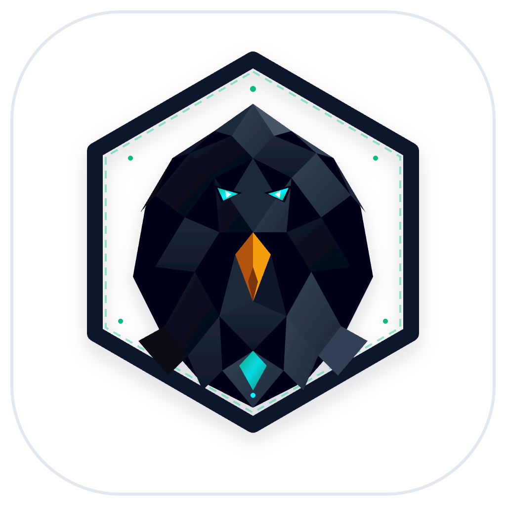
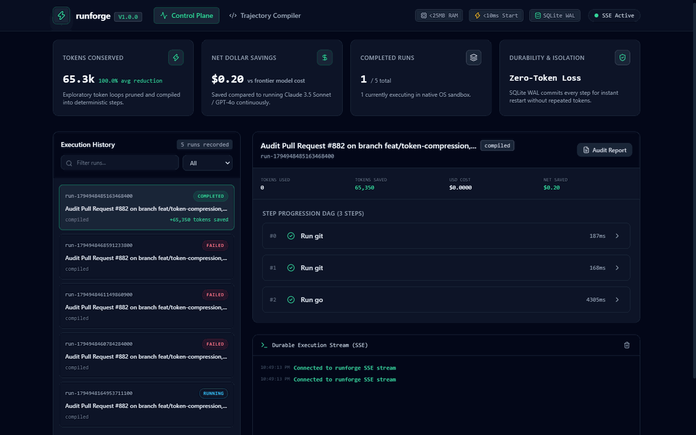
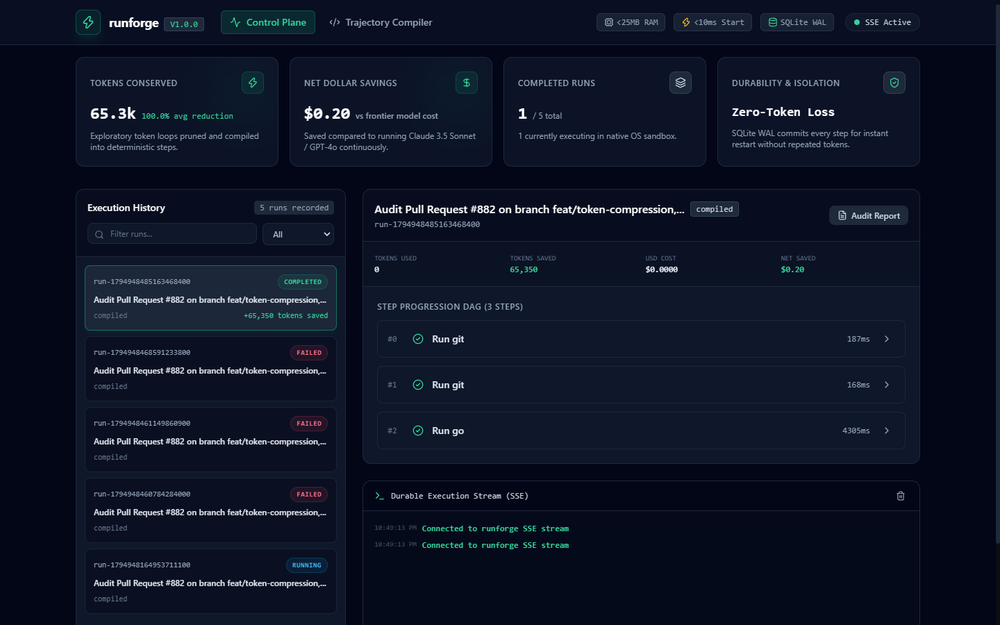
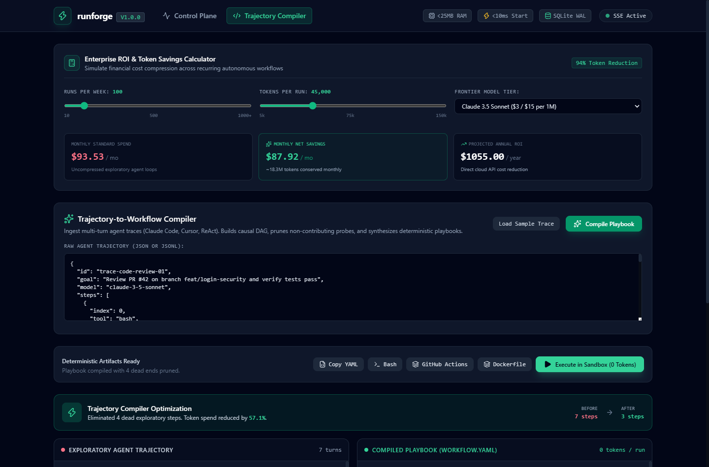
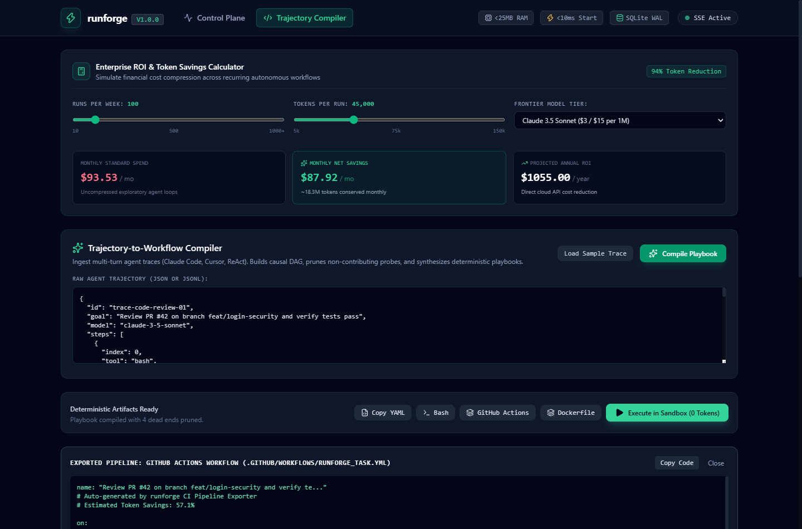
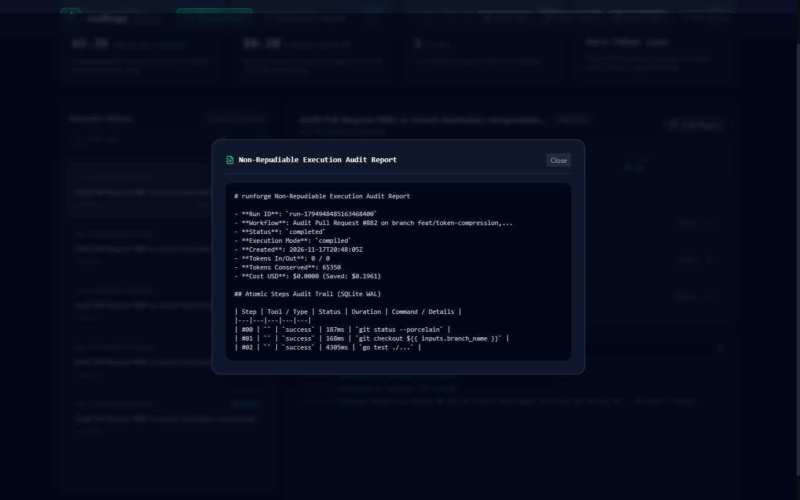
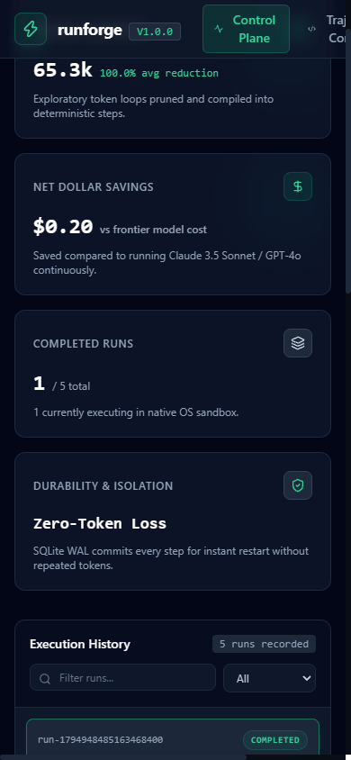

<div align="center">
  
  <h1>runforge</h1>
  <p><strong>Deterministic durable execution engine, trajectory-to-workflow compiler, and control plane in Go for autonomous AI agents.</strong></p>
  <p>
    <a href="#key-capabilities">Key Capabilities</a> •
    <a href="#live-demonstration">Live Demo</a> •
    <a href="#system-architecture">Architecture</a> •
    <a href="#control-plane-studio-and-ui">Control Plane Studio</a> •
    <a href="#installation-and-quick-start">Quick Start</a> •
    <a href="#cli-usage">CLI Usage</a> •
    <a href="#license">License</a>
  </p>
</div>

---

`runforge` is a single-binary control plane and durable runtime designed to eliminate token waste and execution instability in autonomous agent workflows (such as Claude Code, Cursor, OpenCode, AutoGen, and CrewAI).

By capturing exploratory ReAct trajectories from initial agent executions, `runforge` builds a causal dependency graph, prunes dead-end probes, and compiles validated sequences into deterministic playbooks (`workflow.yaml` or standalone native scripts). Subsequent recurring runs execute rigid commands directly inside native operating system sandboxes with zero LLM tokens, cutting recurring token consumption by 90% to 95%.

---

## Live Demonstration



---

## Key Capabilities

1. **Zero-CGO Single-Binary Architecture**:
   - Compiles into a self-contained executable under 25MB (14.8MB production footprint) with no external C runtime dependencies.
   - Starts in under 10 milliseconds with an idle resident memory footprint under 25MB RAM.
   - Eliminates heavy Node.js 24+ runtimes and mandatory Docker daemon prerequisites.

2. **Trajectory-to-Workflow Compiler**:
   - Ingests exploratory multi-turn agent traces (ReAct JSON format and Claude Code JSONL transcripts).
   - Constructs a causal dependency DAG identifying which actions contributed to final validated outcomes.
   - Prunes redundant duplicate file reads, failed directory probes, and non-contributing exploration branches.
   - Synthesizes deterministic playbooks with automated verification gates (`exit_code == 0`) and dynamic input parameterization (`${{ inputs.branch }}`).

3. **Durable Step Ledger (Pure Go SQLite WAL)**:
   - Logs every step, tool call, process output, environment change, and checkpoint directly into an embedded SQLite database using Write-Ahead Logging (WAL).
   - Recovers interrupted or crashed executions immediately without duplicating completed steps or burning additional tokens.

4. **Native Operating System Sandboxing**:
   - Windows: Employs Windows Job Objects (`windows.CreateJobObject`) to enforce hard memory caps and guarantee process-tree termination on completion.
   - Linux: Utilizes Linux namespaces and process isolation.
   - Cross-platform direct runner with environment sanitization and execution timeouts.

5. **Live Recording Reverse Proxy**:
   - Built-in HTTP proxy (`runforge proxy`) that intercepts `/v1/chat/completions` from agents in real time.
   - Forwards traffic upstream with zero latency while recording every tool call directly into SQLite WAL.
   - Compiles trajectories automatically upon session termination.

6. **Drift Self-Healing with SLMs**:
   - Detects when a compiled deterministic command fails due to repository changes (e.g. moved files or modified flags).
   - Invokes a low-cost model (Gemini Flash or local Llama 3.1 8B) to diagnose the error, repair the command, and re-execute in the sandbox.

7. **Time-Travel and Interactive Step Debugger**:
   - Step-by-step CLI (`runforge run --step`) and Web console execution.
   - Inspects state variables, allows variable overrides, and supports rewinding to earlier SQLite checkpoints.

8. **Enterprise CI/CD Exporter**:
   - Translates compiled playbooks directly into production CI workflows (GitHub Actions, GitLab CI, Dockerfile) with zero agent token dependencies.

9. **Embedded React 19 Control Plane Studio**:
   - Embedded directly into the Go binary via `//go:embed` and served locally on port `7777`.
   - Features real-time Server-Sent Events (SSE), execution DAG visualizers, trajectory diffs, and Human-in-the-Loop approval gates.

---

## Control Plane Studio and UI

### Desktop Control Plane Dashboard
Authentic live view of active runs, token reduction metrics, step progression DAG, and real-time SSE execution logs:



### Trajectory Compiler and Diff View
Side-by-side comparison of raw exploratory agent traces versus compiled deterministic playbooks, featuring the interactive ROI savings calculator:



### Production CI/CD Pipeline Exporter
Exporting compiled playbooks into native GitHub Actions workflows with zero LLM runtime overhead:



### Non-Repudiable Execution Audit Report
Cryptographic and transactional audit trail modal generated directly from the SQLite WAL ledger:



### Responsive Mobile Interface
Fully adaptable mobile interface verified on smartphone viewports (390x844):

<div align="center">
  
</div>

---

## System Architecture

```
       +-------------------------------------------------------------+
       |               AI Agent Harness / Client Run Request         |
       |         (Claude Code, Cursor, Custom Agent, CLI, API)       |
       +-------------------------------------------------------------+
                                      |
                     Inbound Run Trigger (CLI / HTTP / SDK)
                                      v
       +-------------------------------------------------------------+
       |                     runforge Core Engine                    |
       |                    (High-Performance Go CLI)                |
       |                                                             |
       |  +---------------------+        +------------------------+  |
       |  | Run Dispatcher and  |------->| Durable State Ledger   |  |
       |  | Task State Machine  |        | (Pure Go SQLite WAL)   |  |
       |  +---------------------+        +------------------------+  |
       |              |                               |              |
       |              v                               v              |
       |  +-------------------------------------------------------+  |
       |  |               Execution Sandbox Engine                |  |
       |  |  - Windows: Job Objects (Process Tree and RAM Caps)   |  |
       |  |  - Linux: Namespaces and Process Isolation            |  |
       |  |  - Direct: Isolated process runner with env filters   |  |
       |  +-------------------------------------------------------+  |
       |                              |                              |
       |                              v                              |
       |  +-------------------------------------------------------+  |
       |  |          Trajectory-to-Workflow Compiler              |  |
       |  |  - Ingestion Adapters (Claude JSONL, ReAct traces)    |  |
       |  |  - Causal Dependency Graph Builder (DAG)              |  |
       |  |  - Dead-End Pruner and Redundancy Stripper            |  |
       |  |  - Deterministic Playbook Synthesizer (workflow.yaml) |  |
       |  |  - Native Script Generator (Bash, Python, PowerShell) |  |
       |  +-------------------------------------------------------+  |
       |                              |                              |
       +------------------------------|------------------------------+
                                       |
                                       v
       +-------------------------------------------------------------+
       |                  Enterprise Control Surfaces                |
       |  1. Embedded React 19 Studio (Local HTTP :7777)             |
       |  2. Compiled Deterministic Playbook (workflow.yaml)         |
       |  3. Prometheus Metrics and Non-Repudiable SQLite Audit Log  |
       +-------------------------------------------------------------+
```

---

## Installation and Quick Start

### Build from Source

Requirements: Go 1.22+ and Node.js 20+ (for building the web assets).

```bash
# Clone the repository
git clone https://github.com/alexandrmotologa/runforge.git
cd runforge

# Build the embedded React 19 studio and Go executable
make build

# Or compile the Go executable directly if web assets are bundled
go build -ldflags="-s -w" -o runforge.exe ./cmd/runforge
```

### CLI Usage

#### 1. Compile an Agent Trajectory
Ingest a recorded trace and synthesize a deterministic playbook and native script:

```bash
runforge compile examples/sample_trajectory.json \
  -o workflow.yaml \
  --script run_task.sh
```

Sample output:
```
[OK] Wrote compiled playbook to workflow.yaml
[OK] Generated standalone script: run_task.sh

================ Compilation Summary ================
Original Turns:       12
Dead Ends Pruned:     9 (75.0% reduction)
Deterministic Steps:  3
Conserved Tokens:     ~10190 tokens / subsequent run
Net USD Savings:      ~$0.0306 per execution
=====================================================
```

#### 2. Execute a Compiled Playbook
Run the workflow inside the native OS sandbox:

```bash
runforge run workflow.yaml --param branch_name=feat/token-compression
```

#### 3. Start the Control Plane Studio
Launch the local HTTP server and embedded React 19 interface on port 7777:

```bash
runforge serve --port 7777
```
Open `http://localhost:7777` to inspect live DAG progression, savings charts, and approvals.

#### 4. Live Recording Reverse Proxy
Intercept LLM calls from any agent in real time and automatically compile playbooks on session exit:

```bash
runforge proxy --port 8080 --target https://api.openai.com -o workflow.yaml
```

Configure your autonomous agent or script:
```bash
export OPENAI_BASE_URL=http://localhost:8080/v1
```

#### 5. Interactive Step Debugger and Time Travel
Step through deterministic workflows one action at a time with variable inspection and checkpoint rewind:

```bash
runforge run workflow.yaml --step
```

#### 6. Export to Production CI/CD Pipelines
Translate compiled playbooks directly into native CI automation (zero agent tokens required):

```bash
# Export GitHub Actions workflow
runforge export-ci workflow.yaml --target github-actions -o .github/workflows/task.yml

# Export standalone container recipe
runforge export-ci workflow.yaml --target docker -o Dockerfile
```

#### 7. Resume an Interrupted Run
Resume execution from the exact SQLite WAL checkpoint without repeated steps:

```bash
runforge resume <run_id>
```

---

## Playbook Specification (`workflow.yaml`)

Compiled workflows use a clear, declarative schema:

```yaml
version: 1
name: "Audit Pull Request on branch feat/token-compression"
description: "Compiled deterministic workflow synthesized from agent trace"

inputs:
  branch_name:
    type: string
    default: "feat/token-compression"
    description: "Target Git branch name"

steps:
  - id: step_01
    name: "Run git"
    type: command
    run: "git status --porcelain"
    assertions:
      - "exit_code == 0"

  - id: step_02
    name: "Run git"
    type: command
    run: "git checkout ${{ inputs.branch_name }}"
    assertions:
      - "exit_code == 0"
    depends_on:
      - step_01

  - id: step_03
    name: "Run go test"
    type: command
    run: "go test ./..."
    assertions:
      - "exit_code == 0"
    depends_on:
      - step_02

metadata:
  compiled_at: "2026-11-17T20:17:27Z"
  original_tokens: 65350
  compiled_tokens: 0
  estimated_savings_pct: 75.0
  source_agent: "Claude Code"
```

---

## Token Cost Compression Formulation

Let $C_{\text{frontier}}$ denote the cost per token of the exploratory model, $C_{\text{slm}}$ the cost per token of the lightweight model, and $N_{\text{runs}}$ the total execution count:

$$\text{Cost}_{\text{standard}} = N_{\text{runs}} \cdot \left( T_{\text{explore}} \cdot C_{\text{frontier}} \right)$$

$$\text{Cost}_{\text{runforge}} = \left( T_{\text{explore}} \cdot C_{\text{frontier}} \right) + (N_{\text{runs}} - 1) \cdot \left( T_{\text{semantic}} \cdot C_{\text{slm}} + T_{\text{code}} \cdot 0 \right)$$

Because compiled deterministic commands execute natively within the sandbox without token consumption ($T_{\text{code}} \cdot 0$), recurring token expenditure approaches zero for rigid steps, yielding:

$$\text{Net Savings Ratio } R_{\text{savings}} \ge 0.90 \quad (\text{for } N_{\text{runs}} \ge 10)$$

---

## License

MIT License. See [LICENSE](LICENSE) for details.
